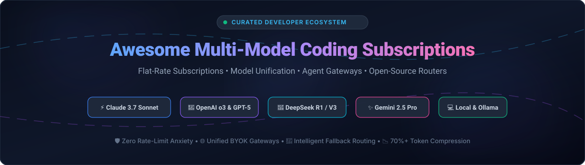

# ⚡ Awesome Dedicated Multi-Model Coding Subscriptions

<div align="center">



<p align="center">
  <strong>A curated index of flat-rate multi-model AI coding subscriptions, self-hosted proxy gateways, and open-source coding agents.</strong><br/>
  <em>Eliminate per-token anxiety, bypass rate limits, and orchestrate frontier models seamlessly.</em>
</p>

<p align="center">
<a href="https://github.com/ishandutta2007/Awesome-Awesome-Awesome"></a><a href="https://discord.gg/jc4xtF58Ve"></a>
<a href="https://github.com/ishandutta2007/Awesome-Dedicated-Multi-Model-Coding-Subscriptions/stargazers"></a>
<a href="https://github.com/ishandutta2007/Awesome-Dedicated-Multi-Model-Coding-Subscriptions/network/members"></a>
<a href="https://github.com/ishandutta2007/Awesome-Dedicated-Multi-Model-Coding-Subscriptions/issues"></a>
<a href="https://github.com/ishandutta2007/Awesome-Dedicated-Multi-Model-Coding-Subscriptions/blob/main/LICENSE"></a>
<a href="https://github.com/ishandutta2007"></a>
</p>

</div>

---

## 📖 Table of Contents

- [🎯 Overview](#-overview)
- [📊 Sector Overview & Market Dynamics](#-sector-overview--market-dynamics)
- [🏢 SaaS / Hosted Platforms](#-saashosted-platforms)
- [💻 Open-Source GitHub Projects](#-open-source-github-projects)
- [🛠️ Architecture & Best Practices](#️-architecture--best-practices)
- [🤝 How to Contribute](#-how-to-contribute)
- [💖 Support](#-support)
- [⭐ Star History](#-star-history)
- [⚖️ Disclaimer](#️-disclaimer)

---

## 🎯 Overview

Modern AI-assisted engineering demands switching fluidly between frontier reasoning models (**Claude 3.7 Sonnet**, **OpenAI o3-mini/o1**, **GPT-4.5**, **DeepSeek R1**, **Gemini 2.5 Pro**) and ultra-fast code synthesis models. However, juggling per-provider API usage leads to unpredictable bills, fragmented credentials, and strict concurrency caps.

This repository tracks the leading **Dedicated Multi-Model & Coding Subscription Ecosystem**:
- 🏷️ **SaaS Platforms**: Flat-rate subscriptions, bundled token pools, unified multi-provider routing, and zero-token-anxiety dev plans.
- 🔓 **Open-Source Gateways & Agents**: Production-ready self-hosted reverse proxies, credential multiplexers, intelligent routers, and local coding CLI assistants.

---

## 📊 Sector Overview & Market Dynamics

The global AI coding assistant and agentic software development market is estimated at **$4.1B to $9.8B in 2026** (scaling past **$30B by 2031** with a compound annual growth rate of **~21.5%**).

Market dynamics reflect a **hybrid, highly fragmented developer layer alongside a concentrated foundation layer**:
- 🏛️ **Concentrated Intelligence Layer**: Frontier weights, pre-training clusters, and foundation reasoning models remain tightly held by hyperscalers and frontier labs (Anthropic, OpenAI, Microsoft, Google, DeepSeek).
- 🧩 **Fragmented Application & Gateway Layer**: The developer interface space—encompassing AI-native IDEs, CLI pair-programming agents, proxy routers, and token optimizers—is fiercely fragmented and intensely competitive. Low developer brand switching costs and rapid agentic iterations ensure winner-take-all dynamics have not formed at the interface tier.

---

## 🏢 SaaS/Hosted Platforms

The following SaaS platforms provide unified, flat-rate, or managed subscriptions for multi-model coding workflows. Sorted by **company scale / valuation (descending)**:

| Product | Company Size / Scale (Valuation / Revenue) | Starting Paid Pricing | Free Tier / Free Trial Limits | Key Highlights & Supported Models |
| :--- | :--- | :--- | :--- | :--- |
| **[Codeium](https://omr.com/en/reviews/product/codeium/pricing)** | **$1.25B - $2.85B Valuation** (~$40M-$82M ARR; Series C / Windsurf) | **$35 / user / month** (Teams; Ultimate at $90/mo) | **Free forever plan**: Unlimited single-line and multi-line code completions, limited chat assistant turns, zero data retention on basic tier | 🚀 Full-featured AI IDE & plugin suite (Windsurf), multi-repo indexing, remote indexing, enterprise audit controls. |
| **[Tabnine](https://www.tabnine.com/pricing/)** | **~$102M Total Funding** (Series B / Telstra & Atlassian Ventures) | **$12 / user / month** (Pro; Enterprise at $39–$59/mo) | **90-Day Free Trial** of Pro (full IDE chat agents, custom codebase context, model switching; basic completion forever thereafter) | 🛡️ IDE chat agents personalized to codebase, switchable LLMs (Tabnine custom, GPT-4o, Claude 3.5), on-prem or VPC deployment options. |
| **[Supermaven](https://supermaven.com/pricing)** | **~$48M Valuation** ($12M Series A; Acquired by Cursor/Anysphere) | **$10 / month** (Pro; Team tier available) | **Free forever plan**: Standard-speed completions with 300,000 token context window (Pro unlocks Babbler model & 1M context + $5 chat credit) | ⚡ Ultra-low latency code completion engine with 1M context window; integrates directly into developer editor workflows. |
| **[Bito AI](https://bito.ai/pricing/)** | **~$8.9M Total Funding** (Seed / Vela Partners & Eniac) | **$12 / seat / month** (billed annually, or $15/mo monthly) | **Free forever plan**: Up to 5K lines of code/seat/mo, basic AI chat, CLI commands, and automated code reviews | 🔍 10x developer productivity tools, code review automation, security/vulnerability scanning, SOC 2 Type II compliant. |
| **[Continue Dev Pro](https://docs.continue.dev/)** | **~$3.0M Seed Funding** (Early-stage venture-backed) | **$20 / seat / month** (Teams governance; Enterprise custom) | **Free forever plan (Solo tier: $0/dev/mo)**: Unlimited completions & chat via local models (Ollama) or BYOK cloud endpoints | 🧩 Open-source (Apache 2.0) IDE autopilot extension; Teams plan adds central assistant configuration, secrets management, and team analytics. |
| **[Nous Portal Ultra](https://dev.to/zackchew/nous-portal-explained-plans-models-tools-and-hermes-cloud-9hh)** | **Seed / Early Stage** (Nous Research Ecosystem) | **$20 / month** (Plus; returns $22 in usage credits) | **Free forever plan ($0/mo)**: 50 requests/min (RPM), 500,000 tokens/min (TPM), access restricted to curated free-model catalog | 🌐 Unified subscription for 248 models + 29 embeddings (Claude, GPT, Gemini, Llama, Hermes), built-in Tool Gateway (scraping, sandbox execution). |
| **[DevPass by LLM Gateway](https://devpass.llmgateway.io/pricing)** | **Bootstrapped / Indie** | **$29 / month** (Lite; Pro at $79/mo, Max at $179/mo) | **Free forever plan**: Unlimited Bring Your Own Key (BYOK) gateway proxying; 7-day money-back satisfaction guarantee on paid tiers | 💰 Flat-rate 3x value multiplier ($3 usage per $1 spent) across 200+ frontier models (Claude, GPT-5, Gemini, DeepSeek, GLM) with frontier fair-use pools. |
| **[Synthetic.new](https://synthetic.new/pricing)** | **Bootstrapped / Indie** | **$30 / month** ($1/day flat rate; enterprise usage options) | **Free trial credit**: $10 promotional sign-up credits on registration; no permanent free usage tier | 🔒 High-speed, privacy-first inference with 500 requests per 5 hours (3x Claude rate limits), 512K context, built-in embedding models at no extra fee. |
| **[Command Code Go](https://commandcode.ai/docs/plans/go)** | **Bootstrapped / Indie** | **$1 / month** (Go plan; GOAT plan at $10/mo) | **Free trial**: Initial welcome credits on signup; Go plan offers $10/mo token pool ($3/5hr, $6/week caps) | ⌨️ Terminal-first coding agent (taste-1 adaptive engine); access to 54+ frontier & open models (Grok, Muse Spark, Qwen, DeepSeek). |
| **[OpenCode Go](https://opencode.ai/docs/ar/go/)** | **Bootstrapped / Indie** | **$10 / month** (Go starting tier) | **Free forever plan**: Unlimited free-tier access to preview models (e.g., LongCat 2.5 Preview) with daily rate limits | 📦 Bundled multi-model coding agent access with per-model monthly quotas (GPT, Grok, Qwen, DeepSeek V4 Pro, MiniMax M3). |

---

## 💻 Open-Source GitHub Projects

Curated open-source projects for self-hosted multi-model gateways, coding agents, and token optimization. Each repository includes its official Stars_Count badge linking directly to its stargazer community, **sorted in descending order by GitHub_Stars**:

| Rank | Repository & Stars_Badge | Category | Focus & Key Capabilities |
| :---: | :--- | :--- | :--- |
| 1 | **[OpenCode](https://github.com/sst/opencode)**<br/>[](https://github.com/sst/opencode/stargazers) | Coding Agent & Harness | Multi-provider agentic coding harness (Apache-2.0). Connects Anthropic, OpenAI, Google Vertex, and local Ollama. Non-interactive NDJSON streams, MCP protocol support, and session restoration. |
| 2 | **[Open-WebUI](https://github.com/open-webui/open-webui)**<br/>[](https://github.com/open-webui/open-webui/stargazers) | Unified Gateway & UI | Extensible, self-hosted web interface and unified API proxy supporting OpenAI, Ollama, Anthropic, and custom agents with granular role-based access control. |
| 3 | **[OpenHands](https://github.com/All-Hands-AI/OpenHands)**<br/>[](https://github.com/All-Hands-AI/OpenHands/stargazers) | Autonomous Software Agent | Full-featured autonomous software development agent (formerly OpenDevin). Writes code, fixes bugs, navigates terminal bash sessions, and coordinates complex refactors. |
| 4 | **[RTK (Rust Token Killer)](https://github.com/rtk-ai/rtk)**<br/>[](https://github.com/rtk-ai/rtk/stargazers) | Token Compression Proxy | Ultra-fast CLI proxy (<10ms startup) written in Rust that filters and compresses terminal command outputs before sending context to LLMs, cutting token consumption by 60–90%. |
| 5 | **[Cline](https://github.com/cline/cline)**<br/>[](https://github.com/cline/cline/stargazers) | Autonomous IDE Coding Agent | Autonomous coding agent for VS Code, terminal, and CI/CD pipelines. Plan-and-Act execution modes, file modification approval gates, Model Context Protocol (MCP), and multi-agent coordination. |
| 6 | **[LiteLLM](https://github.com/BerriAI/litellm)**<br/>[](https://github.com/BerriAI/litellm/stargazers) | Universal LLM Proxy | Unified I/O gateway translating 100+ LLM APIs into standardized OpenAI-compatible formats. Features load balancing, key management, spend tracking, fallback routing, and rate-limit mitigation. |
| 7 | **[Aider](https://github.com/aider-ai/aider)**<br/>[](https://github.com/aider-ai/aider/stargazers) | Terminal AI Pair Programmer | Terminal pair programming CLI with full codebase mapping, multi-file editing, auto-git commits, voice-to-code, and support for Claude 3.7 Sonnet, DeepSeek R1, GPT-4o, and local models. |
| 8 | **[LibreChat](https://github.com/danny-avila/LibreChat)**<br/>[](https://github.com/danny-avila/LibreChat/stargazers) | Multi-Model Gateway & Web UI | Multi-provider AI platform unifying Anthropic, OpenAI, Gemini, Ollama, and custom endpoints with code artifacts, presets, agent builders, and multimodal capabilities. |
| 9 | **[Khoj](https://github.com/khoj-ai/khoj)**<br/>[](https://github.com/khoj-ai/khoj/stargazers) | Personal AI & Code Search | Open-source personal AI assistant with local indexing, deep search across repositories, documents, and multiple LLM backends. |
| 10 | **[Continue](https://github.com/continuedev/continue)**<br/>[](https://github.com/continuedev/continue/stargazers) | Open-Source IDE Autopilot | Modular coding extension for VS Code and JetBrains. Connects custom LLM backends (cloud or local Ollama), codebase context retrieval, inline diffs, and centralized team governance. |
| 11 | **[Devika](https://github.com/stitionai/devika)**<br/>[](https://github.com/stitionai/devika/stargazers) | Agentic Software Engineer | Open-source software engineer agent capable of understanding high-level instructions, breaking them into sub-tasks, researching code syntax, and executing web applications. |

### 🛠️ Specialized Open-Source Gateways & Routers

- **[luicode](https://pypi.org/project/luicode/)** — Multi-provider reverse gateway with built-in Admin UI (`http://127.0.0.1:8082/admin`). Supports **15+ coding agents** (Claude Code, Codex, OpenCode, Cline, Hermes, Aider) across NVIDIA NIM, OpenRouter, Groq, xAI, QwenCloud, and custom OpenAI endpoints with automatic fallback routing.
- **[coding-router](https://pypi.org/project/coding-router/)** — Intelligent model router based on the LLMRouter paper. Dynamically routes queries to best-performing and most cost-effective models using weighted utility metrics.
- **[Personal LLM Gateway](https://railway.com/deploy/personal-llm-gateway)** — One-click Railway template deploying LiteLLM, CLIProxyAPI, and PostgreSQL. Enables multi-account credential multiplexing, virtual API keys, budget enforcement, and OAuth persistence.
- **[code-buddy](https://www.npmjs.com/package/@phuetz/code-buddy)** — Multi-LLM coding companion with ensemble and council modes via OAuth-authenticated accounts.
- **[openscire-core](https://pypi.org/project/openscire-core/)** — High-performance execution core and agentic tooling harness.

---

## 🛠️ Architecture & Best Practices

```
┌────────────────────────────────────────────────────────────────────────┐
│                        Developer Client Layer                          │
│        (VS Code, JetBrains, Terminal CLI, Claude Code, Cline, Aider)    │
└───────────────────────────────────┬────────────────────────────────────┘
                                    │
                                    ▼
┌────────────────────────────────────────────────────────────────────────┐
│                    Token Optimization (RTK Proxy)                      │
│       • Filters verbose terminal output (tests, git status, builds)    │
│       • Achieves 60% – 90% token context compression                   │
└───────────────────────────────────┬────────────────────────────────────┘
                                    │
                                    ▼
┌────────────────────────────────────────────────────────────────────────┐
│                  Intelligent Gateway & Router Tier                     │
│               (LiteLLM / coding-router / luicode / DevPass)            │
│  • Virtual API Key Management       • Fair-use & Budget Caps           │
│  • Performance / Cost Routing       • Automatic Failover & Fallbacks   │
└───────────────┬───────────────────┬───────────────────┬────────────────┘
                │                   │                   │
                ▼                   ▼                   ▼
      ┌──────────────────┐ ┌──────────────────┐ ┌──────────────────┐
      │  Frontier Labs   │ │   Open Weights   │ │   Local LLMs     │
      │ Anthropic Claude │ │   DeepSeek R1    │ │   Ollama / vLLM  │
      │ OpenAI o3 / GPT  │ │   Qwen 2.5 Coder │ │   LM Studio      │
      │ Google Gemini    │ │   GLM / Kimi     │ │   Llama.cpp      │
      └──────────────────┘ └──────────────────┘ └──────────────────┘
```

1. **Stack Token Compression with Flat Plans**: Running tools like `rtk` dramatically slashes input token load, saving weekly and hourly rolling limits on flat subscriptions for deep chain-of-thought operations.
2. **Implement Fallback Chains**: Configure multi-provider failovers (e.g. Claude 3.7 Sonnet $\to$ DeepSeek R1 $\to$ GPT-4o) to prevent broken CI pipelines or CLI pair-programming sessions during upstream API outages.
3. **Use Virtual Scoped Keys**: Restrict coding assistants to repo-scoped virtual keys with fixed daily caps rather than distributing root provider master tokens.

---

## 🤝 How to Contribute

Contributions are warmly welcomed! Help keep this directory current, accurate, and comprehensive:

1. 🍴 Fork the repository.
2. 🌿 Create a feature branch: `git checkout -b feature/new-subscription-tool`.
3. 📝 Add or update entries in [`README.md`](file:///C:/Users/ishan/Documents/Projects/Awesome-Dedicated-Multi-Model-Coding-Subscriptions/README.md) following the existing tabular structure (ensure specific pricing, exact free tier limits, and valid links).
4. 🚀 Push your branch and open a Pull Request with a brief explanation.

---

## 💖 Support

If you find this curated ecosystem directory helpful for navigating multi-model coding tools and optimizing your AI spend:

- ⭐ **Star this repository** to help other developers discover it!
- 🍴 **Fork and share** with fellow engineers, platform teams, and AI tool builders.
- ☕ **Support the maintainer**: Consider buying a coffee or becoming a sponsor via the [GitHub Sponsor Dashboard](https://github.com/sponsors/ishandutta2007)!

---

## ⭐ Star History

[](https://star-history.dera.page/#ishandutta2007/Awesome-Dedicated-Multi-Model-Coding-Subscriptions&type=date&legend=top-left)

---

## ⚖️ Disclaimer

- This repository is a **community-curated index** created solely for informational purposes. It does not constitute formal endorsement or affiliation with listed service providers.
- When utilizing multi-provider gateways or credential brokers, ensure compliance with individual provider Terms of Service, rate limit constraints, and data security mandates.
- **Review Fair-Use Thresholds**: "Flat-rate" or "unlimited" claims routinely involve rolling burst limits, hourly request pools, or separate allowances for frontier high-cost models. Always review provider documentation before production deployments.
